# Plan: Supplier Stock Sync for Shopify

The single plan file. Vocabulary is in [GLOSSARY.md](GLOSSARY.md). Decisions that would surprise a reader are in [docs/adr/](docs/adr/). Coding rules are in [CLAUDE.md](CLAUDE.md).

**Contents**
- Part 1: Requirements and decisions
- Part 2: Flows and implementation (diagrams use Mermaid; "section N" in them refers to Part 2's numbering)
- Part 3: Build phases, tests, and what is still needed from you

---

# Part 1: Requirements and decisions

## Requirements
- Dropshipping store. 5–20 Suppliers, 500–5,000 Variants. Each Supplier has its own login and flow.
- Logins use a username and password plus a code (2FA).
- Shopify currently does not track inventory. The system becomes the source of truth for availability.
- Sold Out is shown by setting Shopify inventory to 0. Restore sets it back.
- Flows are built visually (React Flow). Each Supplier is mostly scraped; a feed is a supported Stock Source.

## Decisions

### Mapping
- The unit is the **Variant**, mapped to one or more **Listings** with a priority order. Other Variants of the same product stay available when one runs out.
- A Variant is Sold Out only when every mapped Listing is Out of Stock. It is restored when any one is In Stock.
- Mappings come in by CSV import (SKU, Supplier, URL) plus an editable table. Validation of mappings is on hold. Shopify metafields are a possible later source.
- A Listing page encodes the Variant in its URL where possible. Otherwise the Mapping carries a selection hint (for example "Black / L").

### Stock Status
- Three states: In Stock, Out of Stock, Unknown. Any failed check is Unknown and never changes Shopify.
- Quantity is optional per Listing. A low-stock threshold is a per-Listing setting, off by default.
- A removed page (404 or redirect) is Listing Removed: Out of Stock after confirmation, flagged for review, switchable to Unknown per Supplier.
- Out of Stock needs 2 consecutive reads about 30 minutes apart. In Stock needs 1. Both are editable per Supplier.
- Check interval defaults to every 2–4 hours and is editable per Supplier in the UI.

### Shopify
- The system turns on inventory tracking for mapped Variants, using the single location.
- Quantity written: the Supplier's real quantity when shown, capped at a maximum you set. Otherwise 100, reset on every check. Sold Out writes 0.
- An app created in the Shopify Dev Dashboard (new legacy custom apps can no longer be created in the store admin). Scopes: `read_products`, `read_inventory`, `write_inventory` and `read_orders`. `read_orders` is for polling recent orders to flag them (section 9); webhooks were rejected because they need a public URL. `write_products` is not needed: `inventoryItemUpdate` (turns tracking on) and `inventorySetQuantities` (sets quantity) both require `write_inventory`. `read_locations` may be needed to look up the location. To be confirmed in Phase 1.
- Token: the client credentials grant gives a token that **expires after 24 hours**, so the system requests a new one automatically and never stores it as permanent. Client credentials only works when the app and the store belong to the same organization; otherwise the authorization code grant (a one-time install flow) gives a long-lived token. The client ID and secret are stored encrypted.

### Safety
- Kill switch: if 30% or more of a Supplier's Listings (or more than 20) flip to Out of Stock in one run, the changes become **Pending Approval**.
- Logins: at most 2 failed attempts per run, then the Supplier is paused until you retry. A wrong password pauses the Supplier immediately, because retrying it risks locking the account; a wrong code allows one retry. Sessions are reused so login and 2FA happen only when a session expires.
- A flow that stops finding its elements marks the Listing Unknown, raises a notification with a screenshot, and can be re-run after the flow is fixed.
- Orders containing a Stale Variant, or a Variant that went Sold Out in the last 6 hours (editable), are flagged "verify with Supplier". The system never contacts customers.
- No proxies or CAPTCHA solvers. A blocked Supplier shows "blocked".
- Credentials are encrypted at rest with a key in the server environment, masked in the UI, logs and screenshots.

### 2FA codes
Each Supplier has an ordered list of 2FA methods. The default is **UI code first, mailbox second**.
- **UI code (primary):** after the worker submits the username and password, the dashboard shows a "needs code" prompt. You paste the code. A Login button on each Supplier starts the same flow on demand. Works with any code you can read (email, SMS, authenticator).
- **Mailbox (secondary, optional):** each Supplier keeps your existing login email. A forwarding rule sends Supplier code emails to one dedicated mailbox, read over IMAP with an app password. The Await code node names the sender and how to pull the code out of the message. Your own inbox is not read.
- When both are enabled they run at the same time and the **first code wins**. If the mailbox delivers the code, the prompt is dismissed automatically and no one has to be present. If it doesn't, you paste it.
- Prompt window: 10 minutes (editable per Supplier). An unanswered prompt cancels the run and the Supplier shows "Needs code". It does not count as a failed login. Only a wrong code does.
- Sessions are kept as long as possible by ticking "trust this device" in the flow. The dashboard shows each Supplier's session age.
- An embedded or publicly streamed browser inside the dashboard is out of scope. An optional
  loopback-only noVNC browser can be reached through an SSH tunnel for manual CAPTCHA/login.
- **Manual login** opens an ordinary Chromium, not one driven by Playwright, because a driven browser
  is marked as automated and a CAPTCHA can reject a correct answer. You log in, then press **Done**
  (closing the window counts too). The worker then reads the profile's cookies, checks the
  logged-in marker headless, and saves only the Supplier's own cookies, encrypted. A failed check keeps
  the saved session. See [ADR 0003](docs/adr/0003-manual-login-uses-a-plain-browser.md).

### Dashboard
- Single admin login with 2FA. The data model leaves room for more users later.
- All notifications appear in the dashboard only (ADR 0002): login attention, flow failure, Pending Approval, Supplier unreachable, Stale Variants, Shopify error, plus a daily summary.
- A banner on every page shows each Supplier's last successful check and turns red after twice the interval.
- Screenshots are saved on the server disk, not object storage: last 5 failures per Listing, deleted after 14 days, with the path stored in the database.

### Architecture and deployment
- Python with Playwright and FastAPI. Postgres is the database and the job queue, with no Redis (ADR 0001). React + React Flow dashboard.
- **Backend stack:** Python 3.12, FastAPI, Pydantic v2, SQLAlchemy 2 with Alembic, `httpx` for the Shopify GraphQL API, `imap-tools` for the optional mailbox, `cryptography` (Fernet) for secrets, argon2 and `pyotp` for the admin login, and `uv`, `ruff`, `mypy --strict` and `pytest` as tooling.
- **Frontend stack:** React with TypeScript (strict) on Vite, React Router, **Redux Toolkit with RTK Query** for server data, React Flow, Tailwind mapped to the design tokens, React Hook Form with Zod, and Vitest, Testing Library and Playwright for tests.
- **Look and screens:** Framed sheet style, light theme only, 12 screens. See [docs/DESIGN.md](docs/DESIGN.md).
- One VPS (2 vCPU, 4 GB) running Docker Compose with four containers: **Caddy** (HTTPS and static dashboard files), **API**, **worker**, **Postgres**. The dashboard is served from a subdomain of your store's domain.

### Flow builder
Nodes: Go to URL, Fill, Click, Wait for, Await code (UI and mailbox), Extract, Branch, Save session, and a Code node for odd sites. The editor includes a Test run with step screenshots and a selector picker.

---

# Part 2: Flows and implementation

## 1. System overview

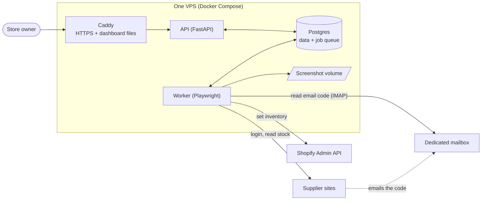

## 2. The check cycle (what happens every interval)

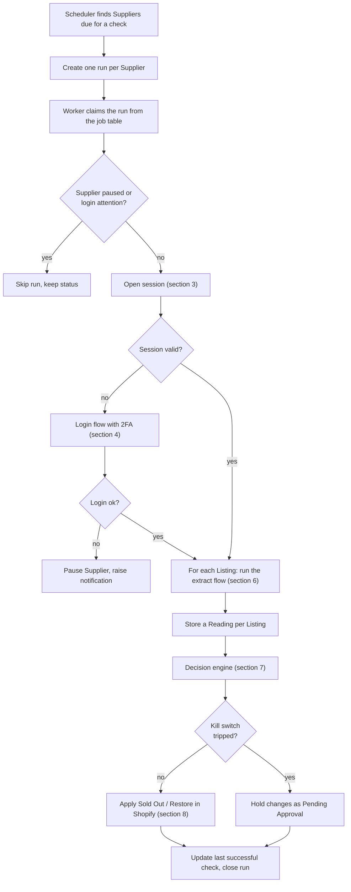

## 3. Session reuse

The worker logs in only when the saved session has expired. This avoids needless logins, codes, and account lockouts.

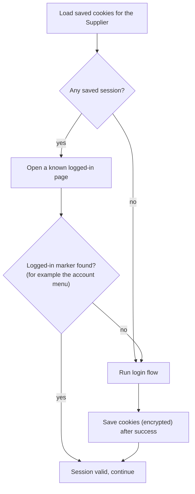

- The logged-in marker is a per-Supplier selector or text that only appears when signed in.
- Cookies are stored encrypted in Postgres, never on disk in plain text.

## 4. Supplier login with 2FA (UI code first, mailbox second)

Each Supplier has an ordered list of 2FA methods, `ui_code` and `email_code`. The default is UI code first. When both are enabled they run at the same time and the **first Login Code to arrive wins**.

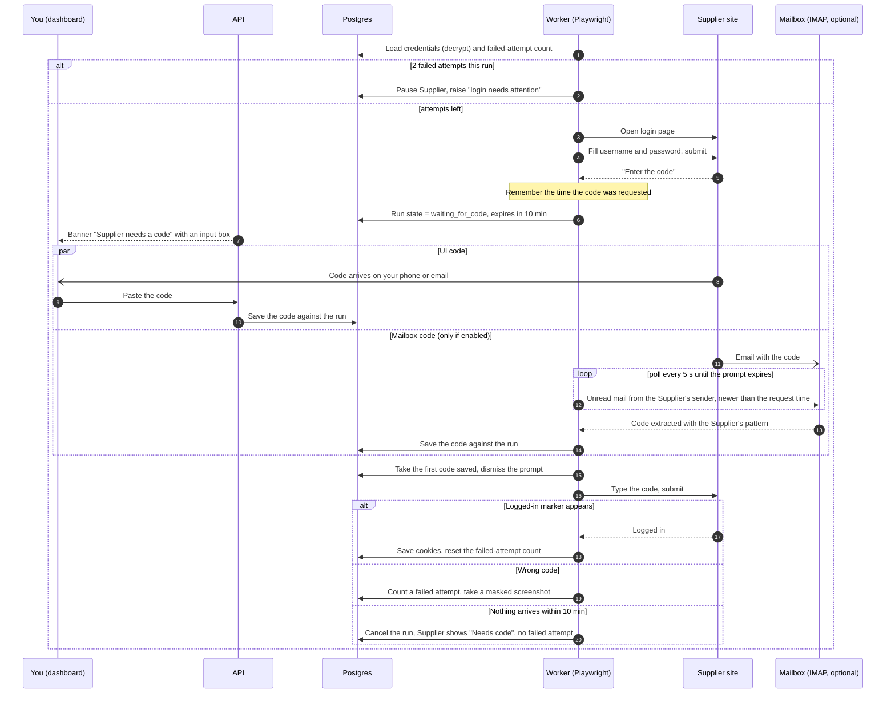

Rules:
- A code from the mailbox is only accepted from the Supplier's configured sender and only if received after the code was requested. This avoids using an old code.
- A pasted code is never reused for a later run.
- A wrong code or a wrong password counts as a failed attempt; an unanswered prompt does not. A wrong password pauses the Supplier at once, since retrying it risks a lockout. A wrong code allows one retry, so after **2 failed attempts in a run** the Supplier is paused until you retry from the dashboard.
- A **Login button** on each Supplier starts this flow on demand, so you can log in when you are at your desk.
- If the Supplier offers a "trust this device" option, the flow ticks it, so the session lasts longer.
- If the mailbox is not set up, only the UI prompt is used, and checks for that Supplier stop until you paste a code when the session expires.
- Password and code fields are masked in screenshots and never logged.

## 5. Mailbox setup (forwarding, optional)

Only needed for Suppliers where you want fully automatic logins. Skip it for Suppliers where you are happy to paste the code.

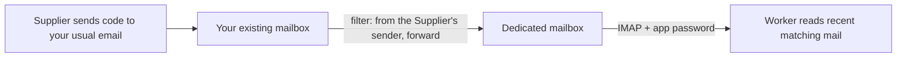

Your existing inbox is never read by the system. Only the forwarded Supplier code emails reach the dedicated mailbox.

## 6. Extracting stock from a Listing

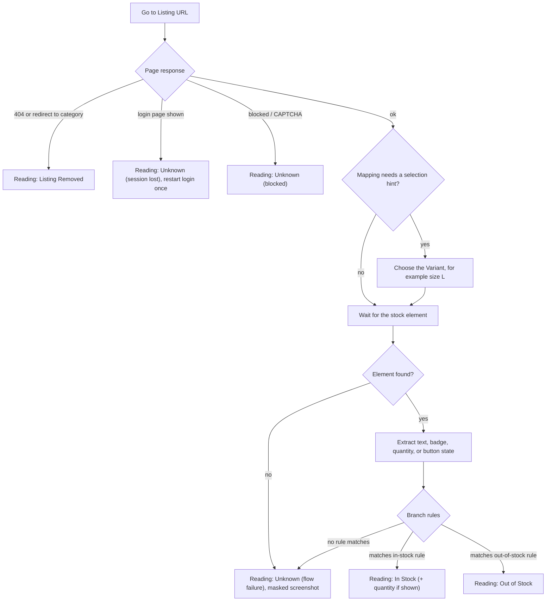

Anything that is not a clear In Stock or Out of Stock reading becomes **Unknown**, and Unknown never changes Shopify.

## 7. Decision engine

Per Listing, readings move the Stock Status as follows.

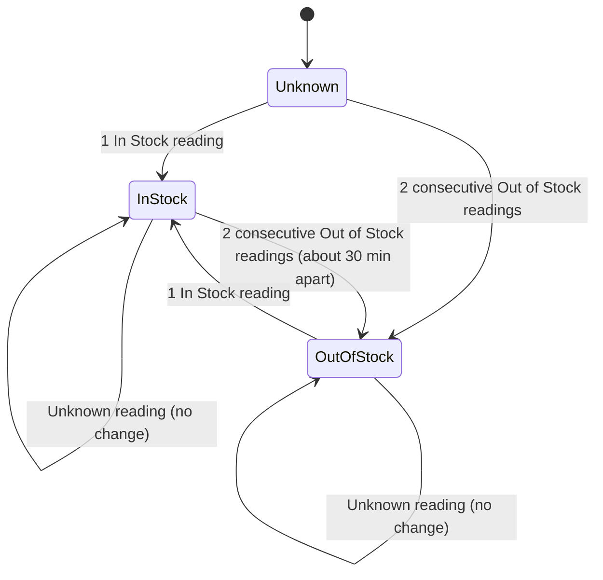

Per Variant, from its Listings:

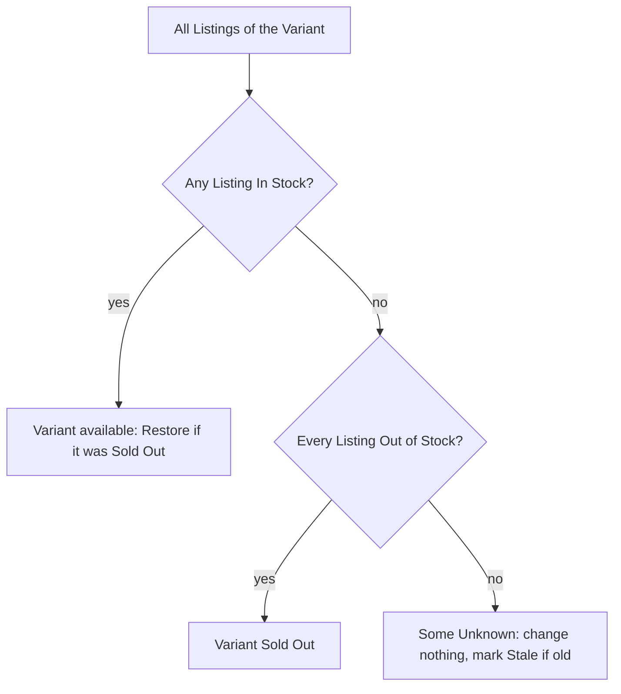

Defaults: 2 reads for Out of Stock, 1 for In Stock, about 30 minutes apart. All three are editable per Supplier.

## 8. Writing to Shopify

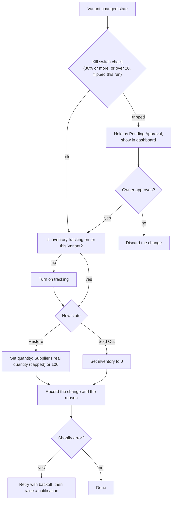

Quantity is also refreshed on every check while the Variant stays In Stock, so Shopify's own order counting never blocks sales.

## 9. Order flagging

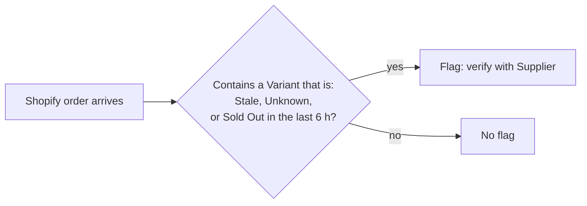

The system only flags. It never cancels orders or contacts customers.

## 10. Failure handling

| Situation | Reading or action | Shopify changes? | Dashboard |
|---|---|---|---|
| Wrong code twice | Supplier paused | No | "Login needs attention" |
| No code pasted or emailed within 10 min | Run cancelled, no failed attempt | No | "Needs code" and the Supplier's Variants go Stale after twice the interval |
| Element not found (site redesign) | Listing Unknown | No | "Flow failure" with masked screenshot and a re-run button |
| Supplier site down or timeout | Listing Unknown | No | "Supplier unreachable" |
| Blocked or CAPTCHA | Listing Unknown | No | "Blocked" |
| Page removed (404 or redirect) | Listing Removed, then Out of Stock after confirmation | Yes, after confirmation | "Listing removed" for review |
| Too many Out of Stock at once | Held | Only after approval | "Pending Approval" |
| Shopify API error | Retry, then notify | Not applied | "Shopify error" |
| No successful check for twice the interval | Variants become Stale | No | Red banner per Supplier |

## 11. Flow definition (JSON the visual editor produces)

The React Flow editor saves a graph like this. The worker walks the nodes in order and follows branch edges.

```json
{
  "supplier": "supplier-a",
  "version": 3,
  "login_path": "/login",
  "logged_in_url": "https://supplier-a.example/account",
  "blocked_if": { "contains": "CAPTCHA" },
  "nodes": [
    { "id": "n1", "type": "goto", "url": "https://supplier-a.example/login" },
    { "id": "n2", "type": "fill", "selector": "#email", "value": "{{credentials.username}}" },
    { "id": "n3", "type": "fill", "selector": "#password", "value": "{{credentials.password}}", "mask": true },
    { "id": "n4", "type": "click", "selector": "button[type=submit]" },
    { "id": "n5", "type": "await_code", "methods": ["ui_code", "email_code"],
      "email": { "sender": "no-reply@supplier-a.example", "pattern": "\\b(\\d{6})\\b" },
      "timeout_s": 600 },
    { "id": "n6", "type": "fill", "selector": "#otp", "value": "{{code}}" },
    { "id": "n7", "type": "click", "selector": "#verify" },
    { "id": "n8", "type": "wait_for", "selector": ".account-menu", "role": "logged_in_marker" },
    { "id": "n9", "type": "save_session" }
  ],
  "extract": {
    "stock_selector": ".stock-status",
    "in_stock_if": { "contains": "In stock" },
    "out_of_stock_if": { "contains": "Out of stock" },
    "quantity_selector": ".qty-left"
  },
  "edges": [
    ["n1","n2"], ["n2","n3"], ["n3","n4"], ["n4","n5"], ["n5","n6"],
    ["n6","n7"], ["n7","n8"], ["n8","n9"]
  ]
}
```

`login_path` (used to notice a lost session), `logged_in_url` (opened to test a saved session; the logged-in marker is the `wait_for` with that role) and `blocked_if` (page text that means a CAPTCHA or block) are required. An edge leaving a `branch` is `["from", "to", "yes"]` or `["from", "to", "no"]`. Reading a Listing is the `extract` section, not a node. Examples of every node are in [docs/flow-nodes.md](docs/flow-nodes.md).

Node types: `goto`, `fill`, `click`, `wait_for`, `await_code`, `branch` and `save_session`. The `code` node for odd sites is not built yet because it runs arbitrary code and needs a sandbox decision first. The editor adds a **Test run** (a screenshot after each step) and a **selector picker**.

## 12. Adding a Supplier

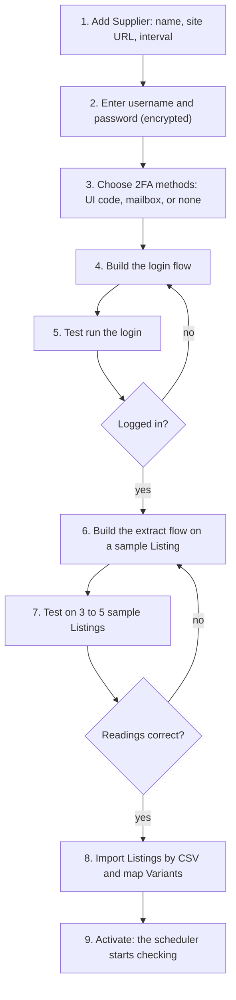

Login is built before extraction, because for most Suppliers stock is only visible after login.

**Picking selectors in the editor.** The worker runs the flow up to the chosen node and returns a snapshot: a screenshot plus a cleaned copy of the page HTML. You click the element and the editor picks the most stable selector (an id, a `name`, or label text, not a long path). You also mark the logged-in marker, an element only visible after login, which session reuse depends on. The snapshot is static, not a live browser. Pages that need a click or hover to show stock get that step added as a node first. If a page is too dynamic to pick from, you type the selector by hand.

**Extract flow.** Click the stock text, badge, or quantity, then set the text that means In Stock and the text that means Out of Stock. For per-size stock, set the selector for the size control and the selection hint on the Mapping.

**Testing.** Each test run shows the reading, the matched rule, and a screenshot. Compare them with the Supplier's site. Test runs never write to Shopify.

**Before the editor exists (Phases 1–5).** A Supplier's flow is a JSON file like the example in section 11, loaded through the API. For a real Supplier, the first flow is written from saved HTML of its login page and a product page (no passwords), and the editor opens that same JSON in Phase 6.

**Odd Suppliers.** A Code node holds a small script for the one step that standard nodes cannot describe. The rest of the flow still uses the editor.

## 13. Data model

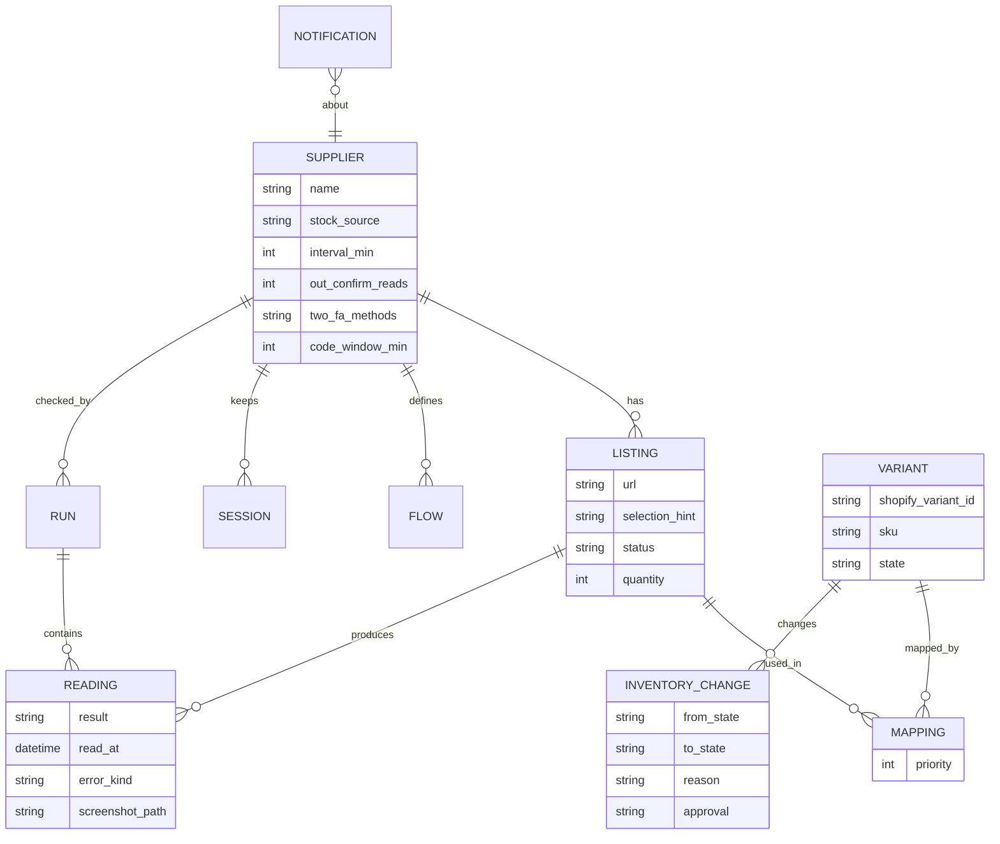

## 14. Project layout

```
inventory-sync/
├── backend/
│   ├── app/
│   │   ├── api/            # FastAPI routes: suppliers, listings, mappings, notifications
│   │   ├── core/           # config, encryption, database
│   │   ├── scheduler/      # picks due Suppliers, enqueues runs
│   │   ├── queue/          # Postgres job table, SKIP LOCKED claiming
│   │   ├── flows/          # JSON flow runner and node implementations
│   │   ├── mail/           # IMAP reader and code extraction
│   │   ├── engine/         # decision engine, kill switch, Stale and order flags
│   │   └── shopify/        # Admin API client: tracking, inventory set
│   ├── tests/
│   └── mock_supplier/      # local test Supplier: login, email code, stock pages
├── frontend/               # React + React Flow dashboard
├── deploy/                 # docker-compose.yml, Caddyfile
├── docs/adr/
├── CLAUDE.md
├── GLOSSARY.md
└── PLAN.md
```

---

# Part 3: Build phases, tests, and open items

## Build phases

Each phase ends with something you can verify. Testing uses the local mock Supplier and a scraping sandbox site, not Amazon or other real shops.

| Phase | Build | Done when |
|---|---|---|
| **0. Setup** | Repo skeleton, Docker Compose, Postgres, config, credential encryption | `docker compose up` starts all containers and the API health check passes |
| **1. Core** | Mock Supplier, hardcoded login with a code pasted through a minimal API endpoint, then the mailbox path, session reuse, one extract, Shopify tracking and inventory update | A mock stock flip changes inventory on a Shopify development store, and the login works with either a pasted or an emailed code |
| **2. Flow engine** | JSON runner, node types, Listing Removed and Unknown handling | The Phase 1 flow runs from JSON instead of code |
| **3. Decision engine** | Confirmation reads, per-Variant rule, Unknown never changes Shopify, multiple Listings | Unit tests cover every state transition and the scrape-error cases |
| **4. Safety layer** | Kill switch, Pending Approval, Stale flags, order flagging, login pause | A simulated bad run is held for approval and changes nothing |
| **5. Dashboard** | Login with 2FA, Suppliers, Listings, CSV import, mapping table, notifications, last-check banner, interval settings | You can add a Supplier and import mappings without touching the database |
| **6. Visual editor** | React Flow builder, selector picker, Test run with screenshots | A new Supplier flow is built entirely in the editor |
| **7. Deploy** | VPS, Caddy, subdomain, backups, first real Supplier | The first real Supplier runs on schedule for a week with no manual fixes |

## Test plan highlights

- **Login:** correct code, wrong code, expired code, no code before the prompt expires (cancelled, no failed attempt), old email present, two wrong codes causing a pause, UI code and mailbox code arriving together (first wins, the other is discarded), mailbox disabled.
- **Session:** valid session reused with no login, expired session triggers one login.
- **Decision engine:** one Out of Stock reading changes nothing, two readings do, Unknown never changes anything, the multi-Listing rule, and restore after one In Stock reading.
- **Safety:** the kill switch holds changes, a page redesign gives Unknown with no Shopify change, and Shopify errors retry and notify.
- **Mock Supplier switches:** flip stock, remove a page, change a selector, force a CAPTCHA page, delay the email.
- **Shopify:** run only against a development store until the first real Supplier is approved.

## Still needed from you
- Confirm each Supplier allows automated logins, and note any that offer a feed.
- Create a Shopify development store, and for it a Dev Dashboard app with the scopes above. Do the same for the live store later.
- Choose the subdomain. The dedicated mailbox and forwarding rule are optional and only needed for unattended logins.
- Name the first Supplier and give 5–10 sample product URLs (no passwords in chat).
